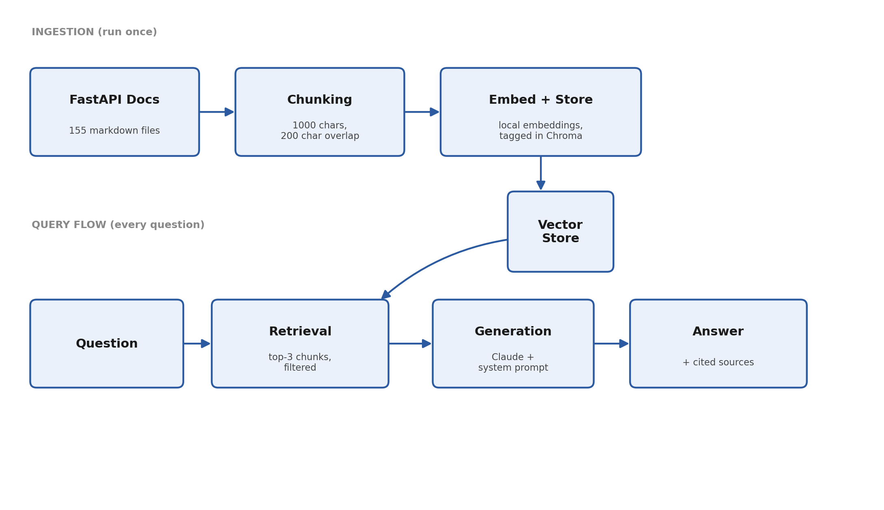

# RAG Docs Assistant

A retrieval-augmented Q&A assistant that answers questions about **FastAPI's official documentation** — built from scratch, evaluated with real metrics, containerized, and deployed.

**Live demo:** https://rag-docs-assistant-e96h.onrender.com
*(Free-tier hosting, so the app spins down after 15 minutes of inactivity — the first request after idle time can take 30-50 seconds to wake up.)*

Ask it things like:
- "How do I add a dependency using Depends()?"
- "How do background tasks work in FastAPI?"
- "What is FastAPI Cloud?"

It retrieves the relevant sections of FastAPI's real docs, answers using only that context, and cites its sources — and says "I don't know" instead of guessing when a question falls outside the documentation.

---

## Why I built this

RAG is one of the most in-demand applied AI skills right now, and most portfolio RAG projects stop at "it retrieves stuff and calls an LLM." I wanted mine to go further — an actual evaluation harness with real numbers, honestly documented limitations, and a real deployment instead of something that only runs on my own machine.

---

## Architecture



**Ingestion (runs once)** — Shallow-clones FastAPI's repo, walks all 155 markdown files under `docs/en/docs/`, and splits them into ~1,900 overlapping chunks (1000 characters, 200 character overlap).

**Storage** — Each chunk is embedded using Chroma's built-in local MiniLM model (no external embedding API needed) and persisted in a local Chroma vector store, tagged with metadata for which file it came from and whether it's a "guide" or "changelog" entry.

**Retrieval** — Given a question, the top-3 most semantically similar chunks are retrieved, filtered to exclude changelog noise. I added that filter after noticing changelog entries were crowding out actual tutorial content in the results — more on that below.

**Generation** — Retrieved chunks are formatted with source labels and sent to Claude with a system prompt instructing it to answer *only* from the provided context, cite sources, and say "I don't know" if the context doesn't cover the question.

**Serving** — A FastAPI backend exposes a `POST /query` endpoint (rate-limited to 5 requests/minute per IP), with a minimal HTML/JS frontend on top.

---

## Evaluation

I wrote 18 test questions by hand — 14 real questions covering different parts of FastAPI, and 4 deliberately out-of-scope questions to check the refusal behavior actually holds up, not just on one lucky example — and scored them automatically:

| Metric | Score |
|---|---|
| Retrieval accuracy (correct source retrieved) | 11/14 (79%) |
| Generation accuracy (correct answer or correct refusal) | 17/18 (94%) |

All 4 out-of-scope questions ("What is the capital of France?", "How do I set up routing in Django?", etc.) were correctly refused — no hallucination.

Run it yourself:
```bash
python eval_runner.py
```

---

## Known limitations

- **`release-notes.md` dominates the corpus** — it's roughly 47% of the total character count (it's FastAPI's full changelog). Chunks from it are tagged `doc_type: changelog` and excluded from default retrieval so they don't crowd out more relevant tutorial content.
- **Fixed-size chunking can cut through markdown structure** — a chunk boundary can land mid-code-block or mid-diagram. It's large enough with enough overlap that this rarely hurts answer quality, but a heading-aware chunker would be a cleaner fix.
- **"Dependency" is genuinely ambiguous** — it means both a Python package dependency and FastAPI's `Depends()` injection system. Retrieval consistently favors the `Depends()` interpretation; that's a real embedding-model limitation, not a bug I introduced.
- **3 of 14 retrieval misses** were on questions about path parameters, static files, and testing — the right docs exist, they just didn't rank in the top-3 for those specific phrasings. Reranking or hybrid (keyword + vector) search would likely fix this.
- **One generation miss**: asked to compare FastAPI and Flask, retrieval succeeded but the model played it safe and said "I don't know" instead of synthesizing a comparison. An overly-cautious failure mode, not a hallucination.

---

## Tech stack

Python · FastAPI · ChromaDB (local embeddings + vector store) · Anthropic Claude API · Docker · Render

---

## Running it locally

```bash
git clone https://github.com/VivekGupta1999/rag-docs-assistant.git
cd rag-docs-assistant
python3 -m venv venv
source venv/bin/activate
pip install -r requirements.txt

# Add your Anthropic API key
echo "ANTHROPIC_API_KEY=your-key-here" > .env

# Build the vector store (one-time — clones FastAPI's docs and embeds them)
python ingest.py

# Run the server
uvicorn main:app --reload
```
Then visit `http://localhost:8000`.

**Or with Docker:**
```bash
docker build -t rag-docs-assistant .
docker run -p 8000:8000 --env-file .env rag-docs-assistant
```

---

## Notes from building and deploying this

A few real bugs hit along the way, worth mentioning since they taught me more than the parts that went smoothly:

- A **Python version mismatch** between local dev (3.9) and the Docker image (3.12) caused a dependency conflict (`click`/`typer`) that only showed up inside the container — fixed by standardizing both environments on 3.12.
- The **embedding model's local cache** lives outside the project directory (`~/.cache/chroma/`), so it wasn't included in the Docker image and had to re-download on first cold start.
- A **misnamed folder** (`chromadb` instead of the correct `chroma_db`) caused the deployed app to silently initialize an empty database instead of the real one — a `NotFoundError` with no obvious cause until I traced it back to the folder name.
- **Rate limiting silently failed in production** despite working locally, because the deployed app sits behind Render's reverse proxy, so `request.client.host` returned Render's internal IP instead of the real visitor's. Fixed by reading the `X-Forwarded-For` header instead.

---

## What I'd build next

- Heading-aware chunking instead of fixed-size splitting
- Hybrid search (keyword + vector) to fix the retrieval misses above
- Bake the embedding model into the Docker image to remove the cold-start delay
- A lightweight agentic extension — letting the assistant also search FastAPI's live GitHub issues, not just the docs, and decide which source is more relevant
